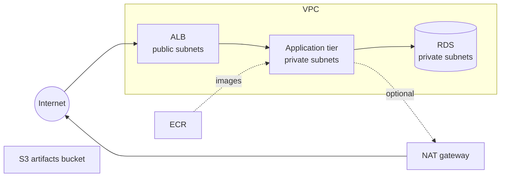

# AWS Terraform Modules

[](https://github.com/jvinayk5/aws-terraform-modules/actions/workflows/ci.yml)

Reusable, secure-by-default Terraform modules for the core building blocks of an AWS environment: networking, container registry, object storage, load balancing and a managed database. A working example wires them together.

> A hands-on reference project built for learning and as a portfolio. It contains no company code, account IDs or credentials.

## Modules

| Module | What it creates | Secure defaults |
|---|---|---|
| [`vpc`](modules/vpc) | VPC, public and private subnets across AZs, internet gateway, optional NAT gateway, route tables | Default security group locked down, no auto-assigned public IPs |
| [`s3`](modules/s3) | Bucket with versioning, encryption, lifecycle rules | Public access blocked, TLS-only policy, SSE-S3 or KMS |
| [`ecr`](modules/ecr) | Container repository with lifecycle policy | Scan on push, immutable tags, encryption |
| [`alb`](modules/alb) | Application Load Balancer, security group, target group, HTTP/HTTPS listeners | HTTP redirects to HTTPS when a certificate is set, invalid headers dropped, TLS 1.3 policy |
| [`rds`](modules/rds) | Database instance, subnet group, security group | Encrypted storage, not publicly accessible, master password managed in Secrets Manager (never in state or code), deletion protection on by default |

## Architecture of the example



## Usage

```hcl
module "vpc" {
  source = "github.com/jvinayk5/aws-terraform-modules//modules/vpc"

  name                 = "demo"
  azs                  = ["ap-south-1a", "ap-south-1b"]
  public_subnet_cidrs  = ["10.0.0.0/24", "10.0.1.0/24"]
  private_subnet_cidrs = ["10.0.10.0/24", "10.0.11.0/24"]
}
```

Run the full example:

```bash
cd examples/complete
terraform init
terraform plan
terraform apply
terraform destroy   # when finished
```

**HTTPS note:** without `certificate_arn` the ALB serves plain HTTP, which is only suitable for short-lived demos. Set a certificate for anything real; HTTP then redirects to HTTPS.

**Cost note:** by default the example creates only the VPC, ECR, S3 and ALB. The ALB is billed hourly. The NAT gateway and the database cost more and are off unless you set `enable_nat_gateway = true` or `create_database = true`. Always run `terraform destroy` after testing.

## Quality checks

The CI pipeline runs on every push and pull request:
- `terraform fmt -check` for formatting
- `terraform init` and `terraform validate` for every module and the example
- A Trivy infrastructure-as-code scan that fails on CRITICAL findings

## Layout

```
modules/     vpc, s3, ecr, alb, rds
examples/    complete: all modules composed together
.github/     CI workflow
```

## Author

Vinay Kumar J - [GitHub](https://github.com/jvinayk5)

## License

MIT
